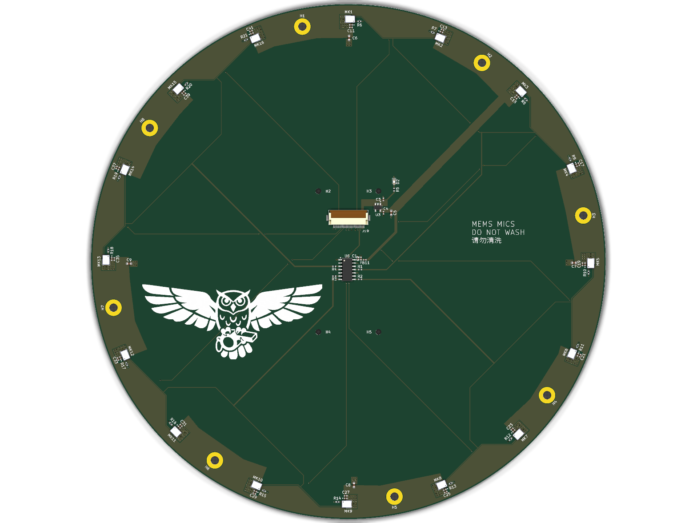
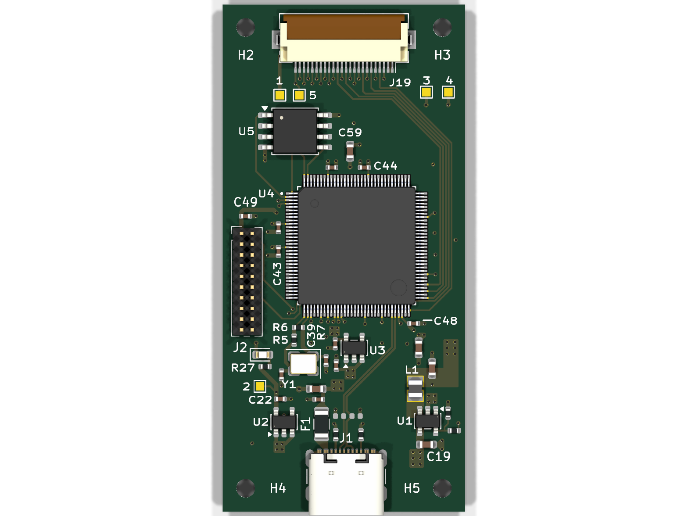
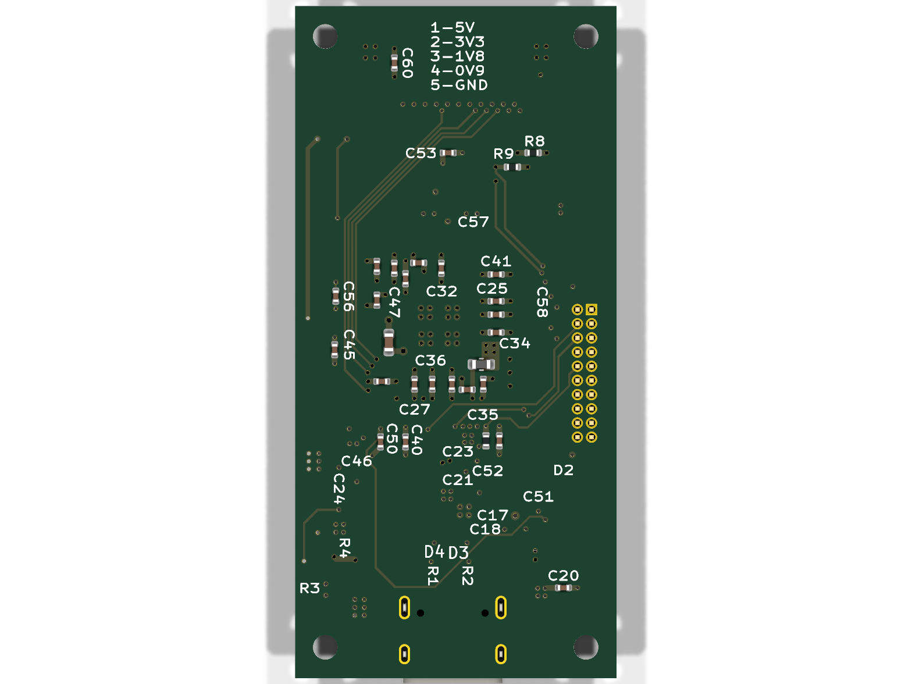
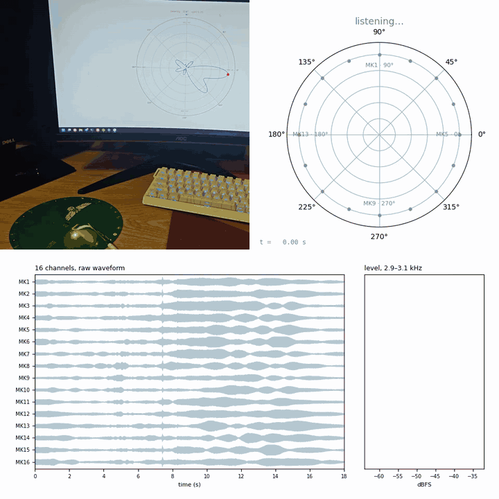

# Whistler: 16-Channel USB MEMS Microphone Array (Open Hardware)

Whistler is an open-source 16-channel circular MEMS microphone array. It plugs
into a computer over USB-C and works as a standard USB Audio Class 2 (UAC2)
microphone, with no drivers to install. An XMOS XU316 (xcore.ai) captures the
16 PDM microphones and streams them at 48 kHz. This repository has the KiCad
PCB design files, a BOM and JLCPCB production files, and the firmware.

| Mic array | Motherboard (top) | Motherboard (bottom) |
|---|---|---|
|  |  |  |

<p align="center">
  
</p>

<p align="center"><em>A phone playing a 3 kHz tone is carried once around the array.<br>
Top: the phone video and the direction-of-arrival plot. Bottom: the 16 raw
channels and each mic's level at 3 kHz.</em></p>

## Key features

- **16 microphones:** Infineon IM72D128 PDM MEMS mics on a 188 mm circle with
  36.7 mm spacing. The array is designed for beamforming from about 1 kHz up to
  4.7 kHz, its spatial-aliasing limit.
- **USB audio:** an XMOS XU316 (xcore.ai) streams all 16 channels as a
  48 kHz USB Audio Class 2 microphone over USB-C.
- **Standalone:** boots from on-board QSPI flash, runs on USB bus power, and
  takes firmware updates over USB (DFU).
- **Two boards:** a 2-layer mic array and a 4-layer, 28.8 × 60.2 mm
  motherboard, linked by a 24-pin FFC.
- **Ready to order:** gerbers, a BOM with LCSC numbers, and a JLCPCB
  pick-and-place file for each board.
- **Measured:** a whistle at 125 m outdoors came through at 39 dB SNR on a
  single mic and 51 dB with the 16-mic beam, a 12.7 dB array gain. See
  [docs/measurements.md](docs/measurements.md).


<p align="center"><em>Field test: a whistle blown 125 m away at dusk, with crickets and birds in
the background.<br>Left: a single mic. Right: all 16 mics beamformed toward it.</em></p>

## Microphones

The array uses 16 Infineon [IM72D128V01](https://www.infineon.com/dgdl/Infineon-IM72D128-DataSheet-v01_01-EN.pdf)
XENSIV PDM MEMS microphones, running at 1.8 V with a 3.072 MHz PDM clock (the
datasheet's high-performance mode). Key datasheet figures at that setting:

| Parameter | Value |
|---|---|
| Signal-to-noise ratio | 72 dB(A) |
| Sensitivity | −36 dBFS ±1 dB (1 kHz, 94 dB SPL) |
| Acoustic overload point | 128 dB SPL (10% THD) |
| Dynamic range | 106 dB |
| THD | 0.5% at 94 dB SPL |
| Frequency response | −3 dB at 20 Hz, +3 dB at 19 kHz |
| Directivity | Omnidirectional |
| Ingress protection | IP57 (dust and water) |
| Supply current | 980 µA per mic (typical) |
| Package | 4 × 3 × 1.2 mm LGA |

## BOM cost

The table gives the parts cost per board in USD, not counting PCBs or assembly.
Prices were taken from LCSC on 2026-10-25, with each line rounded up to LCSC's
minimum order:

| | 1 board | 10 boards | 100 boards |
|---|---|---|---|
| Mic array | $48.96 | $34.87 | $31.40 |
| Motherboard | $27.09 | $16.34 | $14.81 |
| **Both** | **$76.05** | **$51.21** | **$46.21** |

Most of the cost is the 16 microphones ($33.57 per array at 10 boards) and the
XU316 ($10.04). LCSC doesn't sell the IM72D128 directly, so the mics are priced
from JLCPCB's parts library. FB11 can be any 0402 ferrite bead of about 600 Ω at
100 MHz.

<details>
<summary>Mic array: price per part</summary>

| Part | LCSC | Qty | 1 board | 10 boards | 100 boards |
|---|---|---|---|---|---|
| IM72D128 MEMS microphone | C5119248 | 16 | $43.36 | $33.57 | $30.37 |
| 24-pin FFC connector, Hirose FH12 | C202112 | 1 | $0.52 | $0.47 | $0.42 |
| TPS7A2018 1.8 V LDO | C963430 | 1 | $1.30 | $0.26 | $0.21 |
| 74LVC125 buffer | C6057 | 1 | $0.83 | $0.17 | $0.13 |
| 1 µF capacitor, 0402 | C14445 | 19 | $0.53 | $0.10 | $0.08 |
| 10 µF capacitor, 0603 | C18800 | 1 | $0.38 | $0.08 | $0.06 |
| 4.7 µF capacitor, 0603 | C1705 | 4 | $0.64 | $0.06 | $0.05 |
| 100 nF capacitor, 0402 | C1525 | 17 | $0.36 | $0.06 | $0.05 |
| LED, 0603 | C12624 | 1 | $0.58 | $0.06 | $0.01 |
| 33 Ω resistor, 0402 | C25105 | 16 | $0.11 | $0.02 | $0.01 |
| 22 Ω resistor, 0402 | C25092 | 4 | $0.12 | $0.01 | <$0.01 |
| 470 Ω resistor, 0402 | C25117 | 1 | $0.12 | $0.01 | <$0.01 |
| Ferrite bead, 0402 | C96691 | 1 | $0.10 | $0.01 | $0.01 |
| **Total** | | | **$48.96** | **$34.87** | **$31.40** |

</details>

<details>
<summary>Motherboard: price per part</summary>

| Part | LCSC | Qty | 1 board | 10 boards | 100 boards |
|---|---|---|---|---|---|
| XU316 xcore.ai processor | C6938291 | 1 | $10.36 | $10.04 | $10.04 |
| W25Q128JW 128 Mbit QSPI flash | C2763561 | 1 | $3.40 | $2.89 | $2.28 |
| USB-C receptacle, GCT USB4105 | C3025063 | 1 | $1.47 | $1.21 | $0.91 |
| 24-pin FFC connector, Hirose FH12 | C202112 | 1 | $0.52 | $0.47 | $0.42 |
| 750 mA resettable fuse, 1206 | C371166 | 1 | $1.08 | $0.22 | $0.17 |
| 2×10 1.27 mm header, xTAG | C22438125 | 1 | $0.81 | $0.16 | $0.13 |
| 2.2 µH inductor | C337893 | 1 | $0.78 | $0.16 | $0.13 |
| 22 µF capacitor, 0603 | C109448 | 1 | $0.76 | $0.15 | $0.13 |
| AP2112K 3.3 V LDO | C23380830 | 1 | $0.56 | $0.11 | $0.09 |
| 100 nF capacitor, 0402 | C1525 | 29 | $0.36 | $0.10 | $0.08 |
| AP2112K 1.8 V LDO | C3021123 | 1 | $0.49 | $0.10 | $0.08 |
| 24 MHz crystal, 3225 | C70590 | 1 | $0.48 | $0.10 | $0.08 |
| Ferrite bead, 0603 | C85833 | 1 | $0.92 | $0.09 | $0.02 |
| 10 µF capacitor, 0603 | C96446 | 2 | $0.87 | $0.09 | $0.07 |
| TLV62569 buck converter | C141836 | 1 | $0.36 | $0.07 | $0.06 |
| TVS diode, 0402 | C558615 | 2 | $0.69 | $0.07 | $0.05 |
| 4.7 µF capacitor, 0603 | C1705 | 3 | $0.64 | $0.06 | $0.04 |
| 1 µF capacitor, 0402 | C52923 | 5 | $0.64 | $0.06 | $0.03 |
| LED, 0603 | C2289 | 1 | $0.53 | $0.05 | $0.01 |
| 18 pF capacitor, 0402 | C1549 | 2 | $0.27 | $0.03 | $0.01 |
| 5.1 kΩ resistor, 0402 | C25905 | 2 | $0.23 | $0.02 | <$0.01 |
| 49.9 kΩ resistor, 0402 | C137969 | 1 | $0.22 | $0.02 | <$0.01 |
| 100 kΩ resistor, 0402 | C25741 | 1 | $0.15 | $0.01 | <$0.01 |
| 1 MΩ resistor, 0402 | C26083 | 1 | $0.15 | $0.01 | <$0.01 |
| 680 Ω resistor, 0402 | C25130 | 1 | $0.12 | $0.01 | <$0.01 |
| 470 Ω resistor, 0402 | C25117 | 1 | $0.12 | $0.01 | <$0.01 |
| 10 kΩ resistor, 0402 | C25744 | 3 | $0.11 | $0.01 | <$0.01 |
| **Total** | | | **$27.09** | **$16.34** | **$14.81** |

</details>

## Project structure

| Folder | Contents |
|---|---|
| [`mic-array/`](mic-array), [`motherboard/`](motherboard) | KiCad 10 projects; ordering files are in each `production/` folder |
| [`lib/`](lib) | Symbols, footprints and 3D models for both boards |
| [`firmware/`](firmware) | XU316 firmware: a prebuilt image and its source |
| [`docs/`](docs) | Renders, [manufacturing notes](docs/manufacturing.md) and [measurements](docs/measurements.md) |

## Quick start

- **Edit:** open either `*.kicad_pro` in KiCad 10. All libraries are included.
- **Order:** upload a board's `production/` files to JLCPCB. Read
  [docs/manufacturing.md](docs/manufacturing.md) first.
- **Flash:** program a new motherboard once over an xTAG on J2. After that,
  updates go over USB (DFU); see [firmware/README.md](firmware/README.md).

```bash
xflash --factory firmware/bin/whistler-mic-aggregator.xe
```

## Licence

Copyright 2026 the Whistler authors.

- **Hardware:** [CERN-OHL-S v2](LICENSE).
- **Firmware:** XMOS Public Licence v1 ([`firmware/LICENSE-XMOS.rst`](firmware/LICENSE-XMOS.rst)).
- **Library parts:** keep their own licences ([`lib/README.md`](lib/README.md)).
