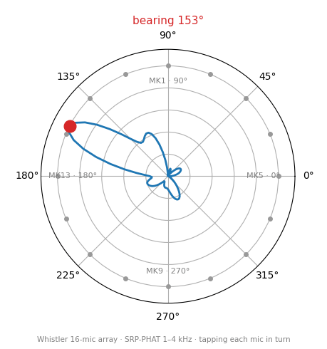
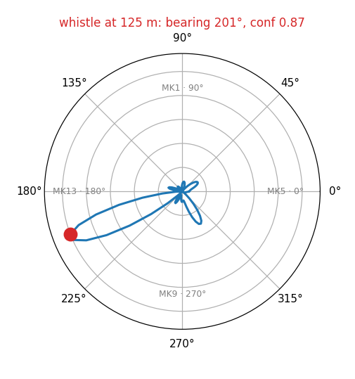
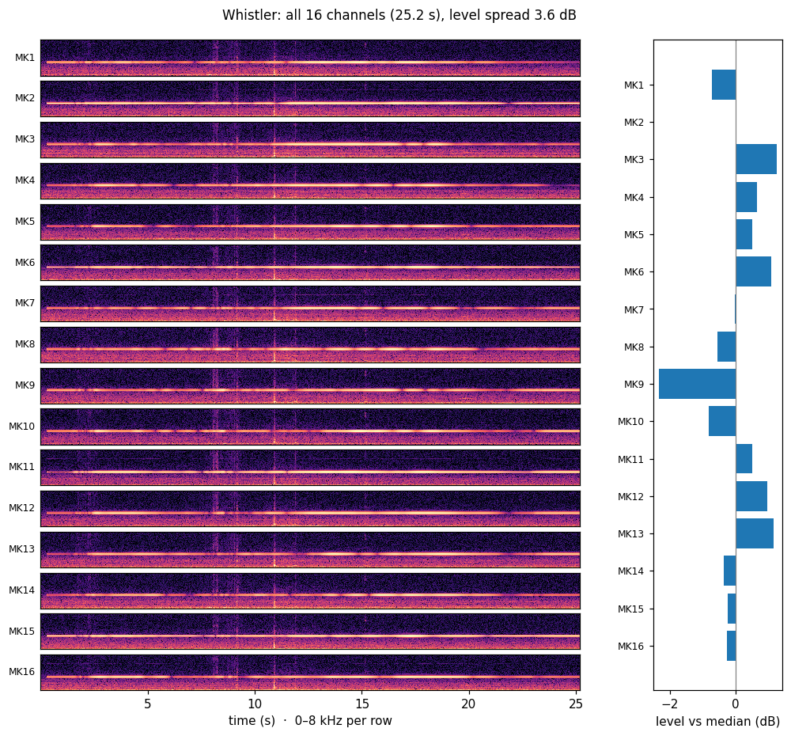
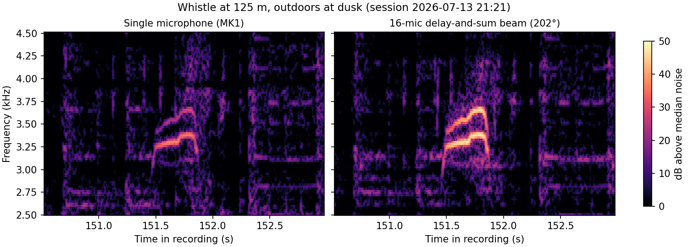

# Measurements

Recordings were made with the firmware in this repo, indoors on a bench and
outdoors in a field. Sound pressure figures (dB SPL) are calculated from the
microphone datasheet's sensitivity.

## Signal chain

The recorded level is set by two gain stages inherited from XMOS's
mic_aggregator example:

| Stage | Gain |
|---|---|
| PDM decimator (lib_mic_array, 3.072 MHz → 48 kHz) | −12.5 dB |
| Fixed gain, `MIC_GAIN_INIT` = 100 | +40.0 dB |
| **Net** | **+27.5 dB** |

With that, a 94 dB SPL tone reads −8.5 dBFS and the recording clips at about
102 dB SPL. The mics themselves go up to 128 dB SPL. The default gain keeps
everyday sound at usable levels in ordinary audio apps. For loud sources, set
`MIC_GAIN_INIT` to 4, which brings digital full scale in line with the mics' own.

## Geometry

The 16 acoustic ports sit on a 188.2 mm circle, 22.5° apart, with 36.7 mm
between neighbours. MK1 is at 90° and the numbering runs clockwise. That spacing
keeps beamforming free of spatial aliasing up to 4.7 kHz, which gives the array
a useful band of about 1–4.7 kHz.

## Channel map and sync

Three tests check that each USB channel carries the mic it should, and that all
16 are sampled together:

| Test | Result |
|---|---|
| 1.1 kHz tone held at MK1 | MK1 is the loudest channel, followed by its neighbours MK2 and MK16. The beam points to 89°, with MK1 at 90°. |
| Tapping each mic in turn (34 taps) | The loudest mic steps from MK1 to MK16 in order, and every mic gets hit. |
| Outdoor whistle (below) | The 16-mic beam gains 12.7 dB over a single mic (12 dB in theory), a figure it only reaches with all 16 channels in order and in sync. |

The channel order matches the table in
[`firmware/README.md`](../firmware/README.md#channel-order).

## Direction finding

The animation is the polar "radar" view (SRP-PHAT over 1–4 kHz, 0.3 s blocks),
rendered from a recording of tapping each mic in turn. The red dot follows the
tapped mic around the ring; grey frames are moments too quiet to give a bearing.

| Source | Result |
|---|---|
| Taps on each mic (34) | Median error of 6°; 29 of 34 within one mic spacing (22.5°) |
| Tone held at MK1 (90°) | 84–96° while the tone is on |
| 3 kHz tone carried around the array | Tracked through the full 360° in about 16 s (the [README](../README.md) animation) |
| Whistle at 125 m | A single sharp lobe at 201° |

## All 16 channels

The spectrograms below show all 16 channels of the circling-tone recording from
the README animation, with each mic's average level on the right. The 3 kHz tone
and the knocks at about 8, 9 and 11 s appear on every channel at the same moment.

With a pure tone, room reflections make neighbouring mics differ in level by up
to 25 dB, so the loudest mic rarely lines up with the source; the radar uses
arrival times instead.

## Noise floor

Noise was measured over the quietest 2 s of a recording in an ordinary room,
with a PC running nearby:

| | Median per mic | Range across the 16 mics |
|---|---|---|
| A-weighted level | 35.8 dB(A) SPL (−66.7 dBFS(A)) | 33.0–37.2 dB(A) SPL |
| Noise density, 1–4.7 kHz | −113.0 dBFS/Hz | |

This floor is set by the room. The datasheet gives the mics' own noise as
22 dB(A) SPL, about 14 dB lower.

## Outdoor whistle at 125 m

Recorded on 2026-07-13 at dusk, with crickets and birds audible. The array sat a
few centimetres above the grass with the mics facing down, and a whistle (about
94 dB SPL at 1 m) was blown 125 m away. The whistle is two tones sweeping
together from 3.25 to 3.65 kHz over 0.4 s.

| | Tonal SNR |
|---|---|
| Single mic (median of 16) | 38.7 dB |
| 16-mic delay-and-sum beam | 51.4 dB |
| Array gain | 12.7 dB |

SNR here is the whistle's strongest spectral line against the median background
level in the 3.1–3.8 kHz band, taken from a few seconds without the whistle.

## Headroom

In a 19-minute outdoor session with strong wind and handling noise, every
channel clipped on up to 0.28% of its samples. The default gain clips
at about 102 dB SPL; for wind or other loud sources, lower `MIC_GAIN_INIT` (see
[Signal chain](#signal-chain)).

## Not tested yet

- Sensitivity against a calibrated sound source.
- Self-noise in a quiet or anechoic room.
- Firmware updates over USB (DFU).
